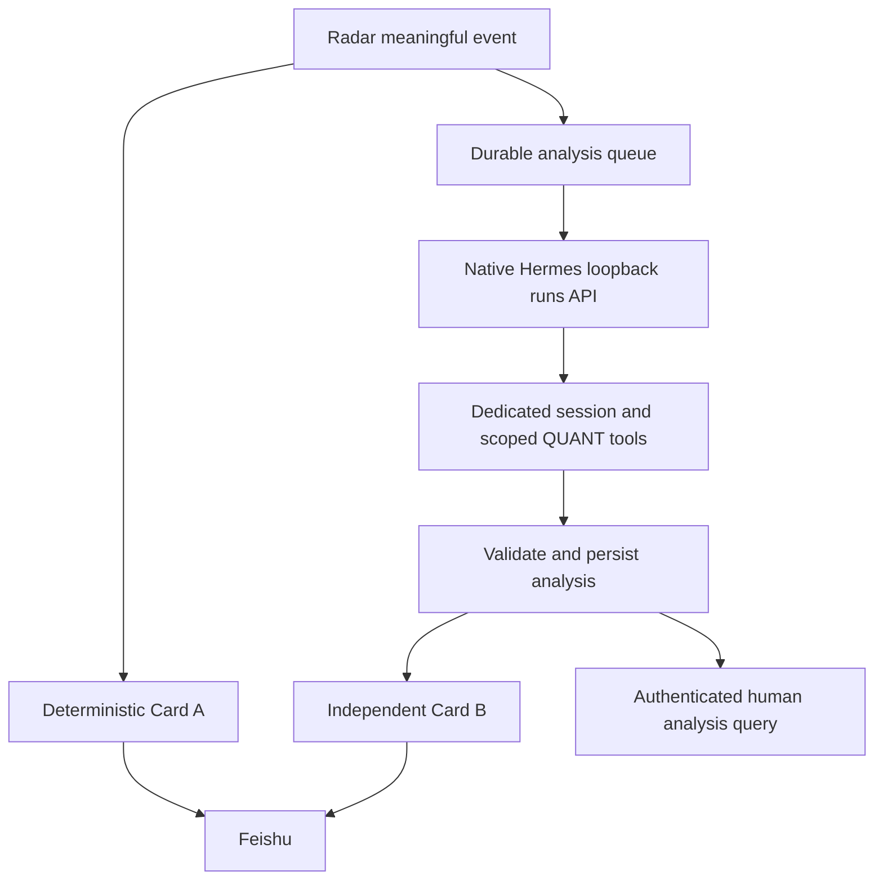

# Native Hermes active agent and cache-aware contract
Date 2026-11-28 UTC+8 | DESIGN RECONCILED / D1 OFFLINE WORKER DELIVERY COMPLETE / QA PENDING / NOT LIVE VERIFIED
Reference Neon V100-S5-HERMES-ACTIVE-AGENT-NEON-REVIEW-20261128 and Sol reconciliation. Use exact [D1 dispatched prompt](../prompts/v1.0/TASK-S5-HERMES-ACTIVE-AGENT-20261128.md).

Reuse Hermes provider authorization, native Agent Loop, sessions, tools, cache; no new harness or persistent broker, no core patch. Stable declared X-Hermes-Session-Key for cache/session, physical session lineage for history, run ID/profile for authorization. No forged human origin. Card A independent, B immutable and linked, no unknown retries. Account unavailable; TRADE disabled.

| Finding | Required resolution |
|---|---|
| F01 hard budget | pre_api_request return ignored/exceptions caught; tool cap cannot bound retries/fallback/auxiliary. 30/60 physical requests; 10/20 runs proposed; 6 summaries; 3/run reservation not proven upper bound. Fail-closed native enforcement or UPSTREAM_HARD_BUDGET_UNENFORCEABLE. |
| F02 principal | _RunLaunch.approval_session_key returns run_id; HERMES_SESSION_KEY per-run, not stable declared key. Trusted admission/lease binding and race proof, otherwise PROACTIVE_PRINCIPAL_BINDING_UNVERIFIED. |
| F03 telemetry | CanonicalUsage default zero may erase missingness. UNKNOWN/null with provenance; main/retry/auxiliary separated. Session continuity != stable prefix != cache read != billing benefit. Dynamic facts user tail; no warming/padding. |
| F04 memory | Tool denylist does not prevent automatic review writes. Prove permanent memory/skill isolation or PROACTIVE_MEMORY_ISOLATION_UNVERIFIED. Native dedicated session persistence allowed. |
| F05 delivery | Existing FeishuSender.send loads deterministic card; independent AI sender/identity, reuse transport/outbox, persisted immutable artifact, authenticated follow-up. |
| F06 sandbox | Analysis unit blocks network and operator directory; scoped protected credentials and bounded egress proposal, no broad directory access. Disabled template only. |

Offline tests cannot prove native live provider, cache savings, or actual runtime. Separate Field approval after QA and real startup proof. Stable prefix and context continuity are intended, not measured. D1 exact 16 paths, no core/transport/research writes.

## Delivery update
Candidate 0d539f6cd29681c703a7196209cda770250b84ee, exact 16 paths. Run5 reports 739/739 and four wheels. PROACTIVE_PRINCIPAL_BINDING_UNVERIFIED, PROACTIVE_MEMORY_ISOLATION_UNVERIFIED and UPSTREAM_HARD_BUDGET_UNENFORCEABLE remain. Production dispatch disabled; no actual provider/cache/runtime proof. Temporary receipts unavailable at initial recheck; independent review pending.
