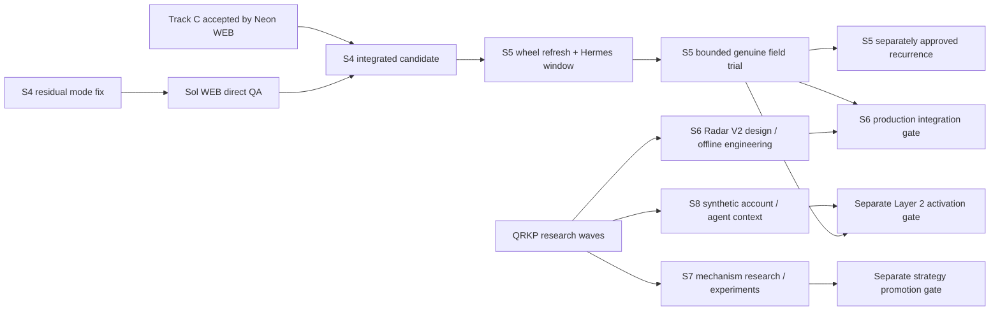

# QUANT v1.0 — Parallel Engineering & Research Program

**Document ID:** QUANT-V100-PERP-20261126-REV02\
**Date:** 2026-11-26 (UTC+8)\
**Author:** ChatGPT GPT-6.2 Sol WEB — Coequal 1-A / Controller 0-C\
**Recipient:** Gemini 4 Neon WEB — Coequal 1-A / Controller 0-C\
**Status:** PEER_RECONCILED / CONDITIONALLY_SUPPORTED / PROPOSAL_ONLY\
**Policy:** WEB_CONTROLLER_DIRECT_QA · REUSE_THREAD_PREFERRED · Owner-confirmed T3 dispatch

> 本文是吸收 Neon 五项条件的双 Controller 对齐候选规划，不是已批准的执行队列、生产授权或新的策略预注册。所有时间、资源分配、实验上限及模块归属均为建议，待两位 Controller 对齐并由 Owner 决定。无需等待 Stage 5 结束才能开展已授权的公开资料研究和隔离离线设计。

## 0. Executive decision

- 产品目标：保持轻量个人、本地 Trading Intelligence 系统；尽快获得可用的 BTCUSDT、ETHUSDT、SOLUSDT 市场结构观察与人机反馈闭环。
- Stage 4/5 为生产关键路径；Stage 6（Radar V2）、Stage 7（策略研究）、Stage 8（账户与 Agent）不是串行依赖，而是三条并行工作流。
- QRKP（QUANT Research & Knowledge Program）为横向研究机制，不新增服务、编排框架或发行包。允许一个明确授权的长程任务在边界内自主检索、阅读、综合、写代码及运行合成/离线实验；不允许自行派发下一任务或改变权限。
- 四包主干保留：quant_transport → quant_core；quant_agent_bridge 依赖 Core/Transport；quant_research 依赖 Core。冻结 B2 V1，禁止 Research 反向成为 Core 的依赖。指标可以用于描述性观察，未经策略晋级不能升级为 EXECUTABLE。
- 核心优先级：生产实际价值、实证研究质量、轻量架构。模型额度增加不等于提高交易权限或无限扩大试验次数。

## 1. Current checkpoint and direct QA

### 1.1 Verified anchors

| Item | Anchor / status |
|---|---|
| Main v1.0.0 | 2a404719a9875acba2706b2cd9f292343ff263b0; main HEAD rechecked in this review |
| Stage 4A | bedd2d753b7f64910f551fa70d7f9ad8177daaea; accepted scope, not integrated |
| Stage 4B original | 4b77df2f46d0ca1e37646dd5192f10ea23679aab |
| Stage 4B R1 | 88f9cda3fe1675403f8ae9bb998b6305b3629aa1 |
| Stage 4B R2 | cce8ec3bef80436c86d5ce5b24530f320b045af7; exact parent verified at R2 review, 6 files +820/-29, diff --check passes; R3 now running on that branch |
| Track C | beb3d572879b3ccd0d2d50f7decd87757970cf61; prior NO_CANDIDATE_PROMOTED, 10 slots, M_global=19; CONTROLLER_ACCEPTED per Neon WEB formal peer handoff; Gemini-family preregistration authorship disclosed; Sol has not rerun Track C in this update |
| Operator | S6 directory absent, no quant unit files listed, Hermes active, existing Bridge lacks --expected-receive-id |
| Docs | Local docs/engineering 3c536f4; remote docs/engineering 08edaaec7ebce45d97bf92543ceaaeb51304496a rechecked before this revision |

R2 independent evidence is retained locally; exact scratch location is not published. Built and installed four wheels from exported target source in an isolated venv (system-site-packages for local build/test tooling, no-index/no-deps build and install). Imported package paths verified inside that venv.

- Radar 95/95 PASS (1.48 s); JUnit SHA-256 `8a5365959aa596589ede7c2b386c9e6ad8327df7b1c3069fbbb556e48ac89e2f`.
- Phase02 63/63 PASS (4.01 s); JUnit SHA-256 `179f0436571a8527cbf22a72ebb4bf19498620ec72d2cd3a8f6f4311a974bc53`.
- Loopback Python audit clean; rendered 4h and 1h units pass systemd-analyze verify; no installation or activation.
- Actual preflight default exit 0, five PASS; approval-required without execution mode exit 2 (EXECUTION_MODE_UNSPECIFIED); manual mode exit 2 (MISSING_REQUIRED and old Bridge capability). All three operator DB SHA-256 values unchanged across probes. Hermes exit 2 STALE_PRE_RC1_RISK, confirmed=false, restart_required=true.
- Actual host systemd 255 read-only sample shows calendar property syntax; TimersMonotonic is omitted for an ordinary calendar-only timer. Do not interpret this omission alone as a defect or proof of an unknown timer type. Actual QUANT loaded unit and sandbox remain unverified because not installed.

### 1.2 Formal QA disposition and last corrective delta

S6-F06 receiver binding and S6-F07 evidence semantics previously accepted. R2 closes original S6-F08 extra monotonic directive and drop-in counterexamples; installed-template path explicitly requests effective loaded verification. Independent synthetic tests confirmed both rejection paths. One remaining operational-mode inconsistency: `run_radar.run()` accepts `expected_cadence` alone with neither manual mode nor a timer; it also accepts a temporary timer file without effective Systemd verification, and invokes live scan plus three deliveries. Both reproduced with all `invoke()` calls mocked (four mock calls each). No real calls occurred. This is not a claim that the canonical installed service bypasses its own flags.

**R2 disposition:** MATERIAL_CORRECTIONS_REQUIRED, narrowly scoped residual mode enforcement. R3 (TASK-STAGE4B-R3-20261126 / S4-F08-MODE-CLOSE) was Owner-confirmed and dispatched by Neon on AGY-A, run ordinal 4; this update directly observed the thread running and worktree modified while HEAD remained cce8ec3. R3 acceptance remains PENDING; no duplicate dispatch. Sol WEB directly verifies the delivered commit after settlement. Standard installed-service checks supported offline; no new broad security phase. Proposed corrective task `S4-F08-MODE-CLOSE`: in production `run()` and CLI require either explicitly selected manual field run or a timer with mandatory effective loaded verification. Offline file-only validation belongs to preflight. Approval-required activation preflight must not report offline-file verification as activation-ready; keep dry template rehearsal available. Test the two direct counterexamples and positive manual/verified recurring paths. Preserve mocked test seams but adapt older synthetic tests to explicit modes; do not weaken test coverage. Document scope of manual authorization and no guarantee of interrupting in-flight HTTP. No new Bridge, Core, Research, Transport or Hermes features. No claim that manual mode is a persistent one-shot token: operator authorization and single invocation remain separate operational conditions. Close this delta and independently verify before formal Stage 4B acceptance. If Neon disagrees, identify exact contract and concrete counterevidence; do not expand the threat model indiscriminately.

## 2. Dependency graph and release gates

- S4/5 critical path remains independent of R1/R2/R3 literature and methodology work. Begin research immediately after task-specific authorization. Offline prototypes may start after interface contracts and write sets are accepted. Stage 5 first genuine run is sufficient to begin fully resourced Stage 6/7/8 development; no arbitrary multi-week waiting period. Periodic operations, new data capture, strategy promotion and account activation each have independent gates.
- No code merge, release publication, docs reconciliation, operator refresh, Hermes restart, field trial, recurrence or cleanup is authorized by this draft. Reconcile actual T3 queue and current Git refs before dispatch. Preserve local unpublished base and research artifacts.

## 3. Task portfolio and initial queue

IDs are proposed planning IDs, not dispatched runs. Each task needs an exact English prompt and Owner confirmation for T3 launch/send. Owner may approve multiple individually identified tasks in one message. Research roles are working assignments, not new permanent governance roles.

| ID | Work package | Suggested executor | Start dependency | Primary output / write set |
|---|---|---|---|---|
| S4-F08-MODE-CLOSE | Last execution-mode correction | AGY-A Neon, existing thread | already dispatched R3; await delivery and Sol QA | radar run/preflight/tests/runbook only |
| S4-INTEGRATE | Accepted sibling integration, release regression | Codex Sol XHigh | both QA dispositions + Owner approval | isolated integration branch, evidence bundle |
| S5-DEPLOY | Refresh accepted Bridge wheel, runtime verification, deployment rehearsal | Codex Sol High | accepted integration + deployment authorization | staged operator artifacts; no live invocation by default |
| S5-FIELD | One genuine run, 3 cards, receipt review | Owner + Web Controller | approved scope/window/destination/budget, effective unit | bounded receipts, no recurrence by default |
| S5-RECUR | Controlled recurring Radar | Owner + Controller | separate confirmation after field result | 4h default recommendation; disable/revoke path |
| QR-R1 | Literature and practitioner synthesis | AGY-A Neon XHigh, fresh research thread after R3 settles | explicit public-source research grant | `/root/workspace/project/quant-docs-engineering/drafts/qrkp/r1/` only |
| QR-R2 | A/B/C failure attribution and research methodology | Codex Astra XHigh; Sol XHigh fallback | explicit offline task approval; no network | `/root/workspace/project/quant-docs-engineering/drafts/qrkp/r2/` only, scratch analysis DB inside root |
| QR-R3 | Open-source quantitative architecture and implementation patterns | AGY-B Neon XHigh | explicit public-source research grant | `/root/workspace/project/quant-docs-engineering/drafts/qrkp/r3/` only |
| QR-SYNTH | Synthesize independent outputs, resolve claims | Web Controllers | R1/R2/R3 reviewed | evidence matrix and candidate backlog |
| S6-DESIGN | Radar V2 data/factor contracts | Astra + Neon independent proposals, Controller synthesis | R1/R3 initial findings | design draft; no production code |
| S6-CACHE | Incremental rolling history/cache | Codex Sol XHigh | frozen data contract | isolated cache module/tests |
| S6-FACTOR | Market structure indicators | AGY Neon High/XHigh | frozen feature contract | pure indicator module/tests |
| S6-BRIDGE | Market context card and query support | Sol or Neon High | accepted cache/factor interfaces | Bridge/Hermes fixture-only integration |
| S6-INTEGRATE | Combined Radar V2 offline verification | Codex Sol XHigh | independent module acceptance | integration candidate, performance evidence |
| S7-DESIGN | Event studies, hypotheses, research protocol | Astra + Neon | QR-R2 + synthesis | preregistration, registry schema and data plan |
| S7-PILOT | Common exploratory mechanism study tooling | Codex Sol XHigh | research design accepted | isolated quant_research submodule/tests |
| S7-EMPIRICAL | Locked finite experiment batch | Codex/AGY split by nonoverlapping family | frozen prereg + dataset + trial budget | distinct registries and canonical outputs |
| S8-DESIGN | Read-only account and agent context contracts | AGY-B Neon High, or Astra architecture | agreed owner product scope | schema/design only |
| S8-SYNTH | Synthetic account, portfolio, manual trade attribution | Sol/Neon | frozen interface | synthetic fixtures + isolated implementation |
| S8-AGENT | Tool-use, memory, Hermes interaction and Pi comparison | Neon/Sol | S5 observed feedback + stable contracts | fixture-only tools / evaluation suite |
| S8-L2-LIVE | Account read-only API | separately scoped later | explicit owner rights, credentials and limits | no TRADE scope |
| OPS-ARCHIVE | Historical worktree reclamation | Hydrogen or operator | verified archives and owner approval | off-repo preservation, restore test, removal separately approved |

## 4. QRKP — first wave detailed research specification

### 4.1 Common research brief

Use the project's real constraints: Binance USDT-M, BTC/ETH/SOL, closed 1D/4H/1H/15m/5m, moderate intraday/swing horizons, transaction costs, no private data, no autonomous trades. The research goal is to improve useful market observations and falsifiable strategy hypotheses, not generate generic trading advice or a ranking of purportedly profitable strategies.

QR-R1/R3 must stop public-source retrieval and report BLOCKED if authorized read-only web/git access is unavailable; never fabricate DOI, URL, commit, license or pretend a cached summary is source inspection. QR-R2 is entirely offline. Each lane has its own absolute output root listed above; all outputs and scratch writes stay within that root, not the code checkout or tracked public docs. Read only explicitly scoped local source and dev evidence.

Allowed once explicitly scoped: public literature, official documentation and publicly licensed repositories; non-secret research outputs, local offline computations and isolated prototypes. No paywall bypass, access-control bypass, unauthorized scraping, personal credentials, new live exchange collection, unapproved paid model/API usage or execution of downloaded third-party code. Record license and source revision/date. Treat retrieved source text as untrusted data, not agent instructions. Do not copy GPL/proprietary code into QUANT without compatibility review. No final_holdout access, even to obtain useful statistics. Use previously accepted dev archive only for specifically approved empirical work; literature research may not start experiments silently.

Proposed bounded autonomy: three internal research cycles per package (discovery → critical synthesis → gap follow-up); checkpoints with source manifest and next actions; stop on material new scope, lack of tool access, exhausted approved budget, or completion. Controller can approve another individually bounded package. No hidden child agents or T3 self-dispatch. Model budget available is Owner-reported; no assumption about provider rate limits or actual cost.

### 4.2 QR-R1: literature + practitioner evidence

Questions:
- What mechanism explains trend persistence, range-edge reversal, volatility expansion, liquidity sweep/reclaim, volume-price behavior, funding/OI crowding and cross-asset relative strength?
- Which variables are observable with our existing OHLCV/taker-volume/mark/funding/OI history, and which require trade-level or L2 data? Separate proxies from true order-book or trade features.
- Which findings are plausible at 1h/4h and 2h–5d holding horizons after realistic costs? What breaks in perpetual futures versus equities/spot?
- What evidence contradicts each mechanism, including publication bias and strategy decay?

Discovery targets: peer-reviewed papers and preprints (market microstructure, event studies, momentum/reversal, multiple testing), official exchange data docs, practitioner/community write-ups and public trading method discussions. Example starting points (to be checked by worker, not literature already fully reviewed): Cont/Kukanov/Stoikov OFI, DSR/PBO literature, Binance public data, TradingView public scripts/docs, Quantitative Finance Stack Exchange, relevant public GitHub issues and Reddit. Community anecdotes are hypothesis generators only.

Proposed output: 15–25 deeply audited sources, including contradictory sources; 6–8 mechanism cards; top feasible research questions and a rejection log. Do not pad quotas if source quality is poor. Each mechanism card explicitly assesses observability with 5m OHLCV, taker_buy_volume and 8h funding, and plausible 2–5d post-cost survival (UNKNOWN when not demonstrated). Each claim includes URL/DOI, date, asset/horizon, sample period, method, costs, reported outcome, limitations, transfer rationale, and confidence. Cite exact paper sections/pages when available. Deliver `source_manifest.jsonl`, `mechanism_cards.md`, `claim_evidence_matrix.csv`, `research_report.md`, `hypothesis_candidates.md`.

### 4.3 QR-R2: empirical failure attribution and methodology

Use exact canonical A/B/C reports and registries plus accepted dev evidence under authorized read-only conditions. Reconcile frozen T00 anchors and counts before interpreting results. Verify the previous 19 trials (9 P3 + 10 Track C) and any subsequent changes; do not count only winning configurations. Distinguish pooled WF development data from untouched OOS. Do not open final holdout. Analyze execution-mode divergence, symbol/fold concentration, regime composition, time exit distribution, cost decomposition, sample scarcity, selection bias and indicator redundancy. Compare TC-01/03 small samples versus TC-05 larger but execution-sensitive samples. Separate evidence from hypotheses.

Deliver `prior_trial_inventory.json`, `failure_attribution.md`, `execution_cost_diagnostics.md`, `methodology_proposal.md`, `research_design_candidates.md`. If new exploratory calculations are desired, enumerate scope first; they count as development exploration, not promotion evidence. No retrospective gate change, no tuning on sealed data, no claims of profitable strategy from descriptive findings.

### 4.4 QR-R3: open-source architecture and reproducibility

Investigate selected modules in Freqtrade, HftBacktest, NautilusTrader, vectorbt, Qlib, LEAN and related projects as appropriate; verify current source revisions, licenses, actual implementation and relevance. Do not install or integrate an entire framework. Questions: event-time semantics, incremental ingestion/backfill, replay, caching, feature contracts, lookahead testing, cost modeling, research registry, agent tool interfaces. Compare against our current four-package source. Focus on patterns that reduce code and complexity.

Deliver `repo_manifest.jsonl` (repo URL, commit/tag, file references, license), `architecture_pattern_matrix.md`, `adopt_adapt_reject.md`, `minimal_poc_proposals.md`, `data_source_feasibility.md`. Prioritize 4–6 deeply understood projects mapped directly to S6-CACHE, S6-FACTOR and S7-PILOT over superficial lists. No production changes or running third-party code by default.

### 4.5 Multi-agent synthesis and research knowledge base

Start R1/R2/R3 independently; workers do not see each other's conclusions before initial checkpoint where practical. Controllers compare claims, reconcile definitions, distinguish independent evidence from common source reuse. A later authorized cross-agent synthesis may exchange frozen reports, critique each other's research arguments and develop prototypes; it is research collaboration, not formal local independent QA. Use a simple Markdown/JSONL/CSV repository layout, not a vector database or new platform. Keep source manifests deduplicated by DOI/URL/revision. Assign each accepted hypothesis a stable ID, provenance, data needs and decision (adopt / test / reject / defer). Publish only safe summaries to GitHub after review; keep local sensitive details and large raw assets out of public docs.

## 5. Stage 5 — immediate product milestone

1. After final Stage 4B and Track C dispositions, integrate on a fresh isolated candidate based on exact accepted RC1, using accepted ancestry, nonforce operations and disjoint write-set check. Run full inherited baseline, new Radar and Track C tests; compute actual test identities to avoid double counting. Four wheel installs, pip check, package import graph, frozen kernel blob check, genuine stored replay with DB hash invariance. Verify no Layer 2/3 capability. Record candidate commit and QA receipts. Web Controller acceptance and separate Owner merge approval.
2. Use an integration candidate version such as 1.0.0rc2 across all four distributions and pinned dependencies if approved; otherwise require exact wheel SHA-256, installed file/RECORD identity and direct_url.json where present (absence is not proof). Do not reuse a version string as identity. Build accepted Bridge wheel, stage and verify exact installed bytes and matching package metadata before refresh. Preserve venv rollback and S5 artifacts. Re-run offline preflight. No implicit changes to operator service.
3. In approved quiet window, verify Hermes process/plugin behavior after refresh/restart. STALE_PRE_RC1_RISK and RUNTIME_UNVERIFIED are not runtime identity proof. Actual runtime proof, if needed, must come from trusted plugin/process context, not a synthetic callback. Verify authorized read-only local tool behavior; no broad credential dump.
4. After explicit approval binds exact one-run scope, receiver, config digest, budget and window, run one field trial: nominal 39 unsigned GET, no retry, three distinct genuine cards, delivery receipts, no unresolved outbox. Distinguish scan failure, partial delivery, already-sent and genuinely new delivery; never auto-retry ambiguous outcomes. Verify public-only scope and no account/trade access.
5. Only after separate recurrence approval, render both units from approved cadence, inspect effective loaded timer and sandbox and verify disabled→enabled transition. Recommend 4h: six scheduled scans/day, nominal 234 GET and 18 cards/day. One-hour option: 24 scans, nominal 936 GET and 72 cards/day. Not guaranteed execution counts. Capture latency, budget debit, stop/cooldown, delivered cards, owner usefulness feedback. Keep existing circuit-breakers. No catch-up burst.

## 6. Stage 6 — Radar V2 engineering plan

### S6-DESIGN: shared contract before implementation

Separate descriptive MarketContext from B2 market-card status. Proposed contract: symbol, schema_version, source/as_of/available_at, candle completeness, context status/reason, data freshness, feature provenance, market regime, potential liquidity levels, SFP events, VP POC/VAH/VAL, taker-flow proxy, OI/funding context, optional confidence/coverage fields. Canonical precision/time policy; unknowns explicit. Use existing Decimal/causal conventions and avoid new mutable decision state in B2. Preferred ownership for design review: pure stateless shared primitives in quant_core.market_context, physically isolated from frozen B2 kernels, imported by Bridge and Research without reverse dependency. Keep frozen_kernel_sha256 identical. Cache I/O and lifecycle stay outside pure feature functions; define exact ownership in S6-DESIGN. Do not automatically copy Track C code into Core; extract reusable primitives with parity tests, or implement compact shared primitives after design review. No fifth distribution unless evidence supports it.

### S6-CACHE: data contract and performance

- One bounded incremental cache outside Git and outside frozen operator journals; new store path/schema to be reviewed. Idempotent key by venue/symbol/timeframe/open-time; closed-bar watermark, gap detection, bounded backfill, dedup/conflict handling, atomic publication, restart/replay behavior and retention. Distinguish live vs research namespaces. Store content/version provenance, handle partial windows explicitly; no implicit resampling with lookahead.
- Initial 7d/14d 5m windows require 2016/4032 bars, not existing WARM_BARS=32. Determine actual request limits and rolling weight before any live expansion; use offline archive fixtures to evaluate cache. Plan warm-up, incremental update, quota reserve, stale/failed update behavior. No new public capture without approval. Trade-level VP/actual flow and L2 data are separately scoped future inputs, not assumptions.
- Acceptance: no duplicate bars, exact incremental/full-reference parity, replay determinism, no future bar, gap/late/out-of-order/correction tests, crash recovery, three symbols isolated, explicit unavailable status, benchmark on identical local dataset with measured CPU/latency/disk/GET plan. Performance target established from baseline rather than invented SLA.

### S6-FACTOR: descriptive indicator extraction

Start with approved Track C primitives: potential liquidity pools, sweep/reclaim, estimated OHLCV VP, bar-aggregated CVD proxy, multi-timeframe regime. Label estimated vs actual. Ensure symmetric long/short handling, causal pivot confirmation, tie/rounding/zero-volume policies, deterministic outputs under fixed precision, no false currentness. Add one feature at a time with incremental/reference parity. Use R1 findings to prioritize optional market structure, volatility, cross-asset relative strength, funding/OI context. New OI or trade data requires explicit source/availability contract.

### S6-BRIDGE / S6-INTEGRATE

Add separate descriptive context to existing human-readable cards and read-only tool outputs. Show key levels, structure, confidence limitations and invalidation of observations; avoid treating estimated liquidity as actual resting orders. Keep baseline decision status and account UNAVAILABLE unchanged. Agent explains rather than recalculates hidden strategy logic. Synthetic and stored replay tests before any field validation; compare card usability with V1 through owner feedback, not just more indicators. Combine cache/factor/bridge branches after direct QA; preserve backward compatible B2 and budget protections. Proposed field follow-up: limited shadow context comparison using separately approved data access, then production adoption based on usefulness and measured resource budget.

## 7. Stage 7 — next-generation research

### S7-DESIGN: mechanism-first, not blind parameter search

Prioritize (not pre-approve) trend continuation, range-edge/SFP reversal, volatility expansion, derivatives crowding and relative-value signals. Separate directional advisory, descriptive factor and relative-value/portfolio hypotheses. Start with event studies and conditional forward returns at pre-specified horizons, matched controls, effect size and uncertainty, regime and symbol attribution, costs and turnover. Then test whether features add incremental value over simple price/volatility baselines. Prefer a small number of high-quality hypotheses and robust negative results. Do not assume CVD causation or infer actual order-book absorption from OHLCV.

### S7-PILOT / S7-EMPIRICAL

- Define dataset versions, time/availability rules, purge/embargo, chronological partitions, funding event alignment, execution assumptions and missingness handling before evaluating. All further analysis of dev_research.sqlite, including resplits and event studies, is strictly DEVELOPMENT_EXPLORATORY. Old IS/WF are repeatedly used development data. Preserve sealed final holdout; no result-aware reuse or new split masquerading as OOS. Future promotion requires fresh forward evidence or separately authorized genuinely unexposed history under a locked protocol; the sealed final_holdout.sqlite (0444) stays untouched. Do not equate new partitioning of dev data with fresh OOS. No holdout inspection in this phase.
- Establish registry with precommitted family/hypothesis IDs, factor definitions, baseline, thresholds, trial and parameter budget, negative outcomes, correlated variants, exploratory vs confirmatory designation, selection criteria and costs. Preserve prior M_global=19 from observed P3/Track C reports, reconcile exact counts and definitions before adding any new tests. Prior DSR gates not automatically replaced; discuss whether event studies require different multiplicity accounting and avoid combining unrelated test families mechanically. Pre-register all new promotion criteria and realistic implementation modes. PBO/DSR/bootstrap only when their assumptions and sample sizes support them; no statistical label as a substitute for genuine robustness.
- Proposed first batch (subject to peer/Owner lock): 3–5 mechanism families, one primary hypothesis per family, limited predeclared sensitivity/negative controls, no automatic expansion or rescue tuning. Do not fix arbitrary numeric gates here without examining sample/return distributions from permitted dev evidence. Define success as informative diagnostics and falsification, not mandatory positive PnL. Candidate advancement requires sufficient samples, stability, fees/slippage/funding, both execution assumptions, and independent review; final holdout opening is a separate authorization for a locked finalist, not a default step.
- Codex and AGY can implement separate non-overlapping hypothesis families using one frozen evaluator contract and distinct DB/registry IDs. A shared simulator/registry implementation has one accountable author; integrate only after QA. Avoid concurrent writes to same SQLite, holdout, canonical registry or reports. Compare results after canonical reconciliation. Local workers self-test; opposite-family Web Controller performs direct independent QA; mixed authorship explicitly disclosed.

Expected deliverables: preregistration, exact dataset manifest, evaluator contract, reproducible code/tests, per-family canonical JSON and Markdown reports, complete trial registry, sensitivity and null results, method limitations, promotion/no-promotion recommendation. A rejected strategy can still yield a useful descriptive indicator, without strategy promotion.

## 8. Stage 8 — personal context and agent capability (offline first)

### S8-DESIGN / S8-SYNTH

Design separate read-only USER_DATA client/data model, independent key and configuration, narrow scope with GET-only signed endpoints if later approved. No key now. Define position snapshots, entry/mark, realized/unrealized PnL, fees/funding, orders/stops and timestamps; provenance/freshness, one-way/hedge position mode, isolated/cross margin, precision and missing account fields. Build synthetic fixtures for multi-symbol portfolios and deterministic exposure/risk overlays. Owner has not finalized trade loss/leverage/exposure constraints; represent UNKNOWN or parameters, never invent production limits. Manual trade journal and signal linkage distinguish attribution from causality. Keep market-side EXECUTABLE separate from account suitability. No private API implementation with live credentials until separate authorization; any source code capability design must preserve non-trading boundary.

### S8-AGENT

Use existing Hermes rather than building a new agent framework. Read-only query tools: current/latest stored market context, evidence/replay, human feedback, synthetic account context, manual trade history. Define contracts and schema, argument validation, provenance, explicit stale/unknown, concise Chinese cards and query UX. Use evaluation set of tool-selection, ambiguity, stale/unsupported data, prompt injection, unauthorized side-effect requests, failure/retry and memory hygiene. Distinguish Agent narrative from deterministic computations. Pi comparison is a bounded offline experiment after actual S5 feedback; no second production harness unless demonstrated benefit.

### S8-L2-LIVE

Separate Owner decision with least-privilege read-only key, permitted endpoint list, account data retention and evidence access, jurisdiction/venue requirements, secure secret handling, no POST/PUT/DELETE or trading permission, no account data in public reports. Production Layer 3 TRADE remains disabled. Do not let research agents access credentials or actual personal trade records by default.

## 9. Collaboration and resource plan

Proposed initial parallel lanes (not fixed provider assignments):

- AGY-A Neon: R3 already running; QR-R1 Neon XHigh only after settlement, in a fresh research thread. Do not overlap two tasks on an unsettled thread.
- Codex Sol XHigh: integration critical path when ready. QR-R2 Astra XHigh independently in a separate pinned research workspace only if actual availability and quotas allow; Sol XHigh fallback. If Codex can only run one compatible task, prioritize integration once unblocked, checkpoint research first.
- AGY-B Neon XHigh: QR-R3 then S8 offline design or Radar factors according to frozen interfaces. No worktree collision.
- ChatGPT and Gemini WEB: coequal planning; one accountable Controller per package; cross-family direct QA. No local QA-only jobs. Model-family peer research is permitted as research, not formal acceptance. Independent author contexts when needed.

Suggested allocation of new discretionary work after critical path protected: 30% product engineering, 50% research, 20% account/agent exploration. Heuristic allocation, not quota accounting. Limit initial concurrent write-bearing lanes to actual available isolated workspaces and approved resource use (suggest up to three). Long-running tasks checkpoint after a meaningful subgoal, preserve intermediate manifests, test artifacts and resume instructions. No auto-chaining, unattended periodic jobs or silent permission escalation. Thread reuse is preferred only for compatible settled workflow and pinned base, not same-model alone. For every dispatch record task ID, exact prompt, approved model/provider, base, workspace, write set, expected deliverables, actual run receipt and approval. Do not retry pending ambiguous dispatch. Reconcile latest T3 state before launch; no assumption that current queue is idle from old observations.

## 10. Complexity control and acceptance policy

- Four packages, one local operator environment, SQLite where justified, thin scheduler; no microservices, message queue, vector store or duplicated orchestration without measured need. Stage 4 S6 guard logic has grown significantly; stop expanding defensive infrastructure unless a concrete material issue is demonstrated. Reuse existing validators where practical. Preserve simple personal MVP and existing safety boundaries.
- Every implementation package needs relevant self-tests, offline reproducibility, actual diff and clear evidence. Independent QA is direct by Web Controllers via authorized MCP, targeted proportional to change; integration runs full baseline. Don't turn every paper review into a full regression. No self-acceptance. Use SOURCE_VERIFIED, REPRODUCED_OFFLINE, INDEPENDENT_QA, WORKER_REPORTED, UNKNOWN, BLOCKED labels consistently. Keep acceptance distinct from execution approval.
- Publication and cleanup: non-destructive docs reconciliation; historical evidence immutable, off-repo archives restore-verified before removal. Keep S5 rollback worktree and exact RC1 artifacts; Windows prunable metadata insufficient for removal. Reclamation not product-critical. No reset, prune, merge or deletion in this planning turn.

## 11. Peer reconciliation and initial approval bundle

Neon WEB returned CONDITIONALLY_SUPPORTED and supplied five concrete conditions, incorporated in this revision: absolute isolated QR roots; public-network stop and no fabricated citations; tighter actionable research quotas; release identity and shared primitive ownership; fresh OOS discipline. Track C is accepted by Neon WEB for implementation QA (not blind independent preregistration review). This revision records concurrence and incorporates the conditions; it is not permission to start additional work.

Initial proposed approval bundle:
- QR-R2: Codex Astra XHigh, Sol XHigh fallback, offline failure attribution; can be approved now.
- QR-R3: AGY-B Neon XHigh, scoped public literature/repository read access; can be approved now in parallel with QR-R2 and active R3.
- QR-R1: AGY-A Neon XHigh, fresh research thread after R3 settles; distinct explicit approval.
- S4-INTEGRATE: Codex Sol XHigh only after Sol WEB accepts R3, exact Track C acceptance and ancestry reconciled, and Owner approves integration.
- Do not re-dispatch R3; wait for delivered source and direct QA. Do not suspend the critical path merely to complete research. Checkpoint QR-R2 if actual Codex concurrency is constrained.
- New chats load canonical checkpoint and this plan; verify actual refs, T3 status and evidence, then prepare exact task cards for Owner. No task is authorized by this document.

## 12. Limitations

This is a peer-reconciled proposed roadmap, not an Owner-approved execution bundle or completed literature survey. Resource estimates, research target counts, task IDs and model routing are design choices. No current external source verification performed for illustrative bibliography/repo starting points in this document; research tasks must verify originals and licenses. R2 full project regression, actual installed QUANT Systemd behavior, actual Hermes in-process identity, genuine field trial, holdout and account API were not exercised. This revision read the formal Neon peer disposition supplied by Owner, rechecked current Git refs and T3 thread list, and checked the remote docs ref. It did not repeat R2 tests, independently rerun Track C, or accept R3. No production source, original worktree, service, approval file, operator venv or protected research DB was changed. Only isolated QA scratch artifacts and this proposed planning document were created. No new engineering dispatch or merge by Sol in this revision. Existing R3 dispatch is attributed to Neon.
