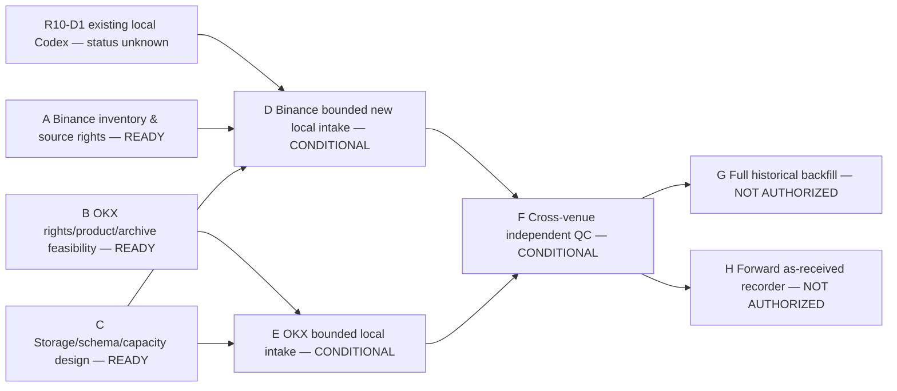

# quant v0.6 — Parallel-First Binance+OKX BTC/ETH Data DAG and Dispatch Queue R1

**Controller time:** 2026-10-16. **Authority:** this exact immutable Controller dispatch commit; **NO delegated data-download or model-score permission** in A/B/C or prepared D-H. **Budget:** USD0 immediately, maximum owner USD20 total absent new approval. **Live status:** R10-D1 local Codex 7-day Binance Vision DEV pilot published at `4d83123243db8cf5ac4fd7b1c00608cb149f7bdc`; no author branch visible as of dispatch; local run may be ongoing. Do not duplicate/restart.

## 1. Dependency DAG

**Wave 1**: A/B/C may execute **in parallel on separate local-agent sessions and branches**. A must not traverse the active R10-D1 task's workspace or re-run its data download; existing BTC data inventory can only be read after owner provides exact allowed root. Without it A finishes a `METADATA_ONLY` report, listing unresolved local witness. B/C are documentary/read-only and independent of that device. **R10-D1** remains a separate prior authorization and must not be silently superseded.

**Wave 2**: D and E are *prewritten only* and **NOT_AUTHORIZED_TO_EXECUTE** until the required documented gates actually pass and exact upstream frozen author SHAs exist; can operate in disjoint worktrees under new owner/Controller scope. F after both (or explicitly revised narrower purpose if one fails). G/H after independent acceptance and additional risk/rights budget grants, never self-activate.

## 2. Complete dispatch/authority matrix

| Task | Dispatch status | Owner / suggested model | Reviewer | Pinned input and prerequisites | Write boundary / parallelism / budget | Deliverable / PASS vs STOP |
| --- | --- | --- | --- | --- | --- | --- |
| A — Binance source and existing-data reuse | **READY_PARALLEL** | LOCAL Codex High (or Gemini NORMAL for fact inventory) | Controller; 1 if actual PIT/right claim | Exact dispatch SHA plus R10-D1 at `4d831232...` and R10-D0 `980a4b6...`; never re-execute current D1; **no owner-local read without explicit directory grant** | Isolated `docs/v06-data-a-binance...` branch, documentation only; no raw paths; Wave 1; $0 | Source×product/coverage matrix, local historic counts `UNVERIFIED` until separately authorized, no duplicate transfers; `A_METADATA_READY` or `A_ACCESS_PROVENANCE_STOP` |
| B — OKX official source feasibility | **READY_PARALLEL** | Gemini NORMAL local (or Codex) | Controller/1 for rights | Exact dispatch; official OKX data portal & V5 docs; no dependency on A/R10-D1 | Separate `docs/v06-data-b-okx...` docs branch; official site **pages only**, no file/API GET; Wave1 $0 | BTC/ETH spot/swap start, product-specific coverage, rights, OI/L2 gaps; `B_DOCUMENTARY_READY` or `B_RIGHTS_PRODUCT_STOP` |
| C — storage/schema/architecture | **READY_PARALLEL** | Gemini NORMAL local; Codex review consequential schema | Controller / 1 if source/clock claims | Exact dispatch; historical 172.33GiB/724GiB *unverified* receipt, A/B pending | Separate `docs/v06-data-c-capacity...` branch; pure plan/model/test fixtures, no raw reads; Wave1 $0 | Versioned manifest schema, 3-tier capacity methodology & scenario only when measured; `C_DESIGN_READY_WITH_LIMITS` or `C_STORAGE_EVIDENCE_STOP` |
| D — bounded Binance local intake | **PREPARED_CONDITIONAL** **NOT_AUTHORIZED_TO_EXECUTE** | Local Codex High | ChatGPT-1 | Frozen A + C and existing R10-D1 receipt; lawful purpose, exact source/product/day/bytes, owner-authorized isolated workspace | New isolated implementation branch / QC script/test/sanitized evidence only; distinct data workspace; Wave2 $0 target and <=$20 ceiling | Real checksum/rows/clock tests, negative synthetic tests; `D_QC_PASS_WITH_LIMITS` or `D_STOP`; no model outcomes |
| E — bounded OKX local intake | **PREPARED_CONDITIONAL** **NOT_AUTHORIZED_TO_EXECUTE** | Separate Gemini BOOST/Codex local | ChatGPT-1 | Frozen B+C; specific rights, official instrument/file/date, owner workspace, host/cap | Separate isolated branch/workspace; Wave2 after gates; no overlapping downloader | Real sample integrity, units, funding/L2 distinctions; `E_QC_PASS_WITH_LIMITS` or `E_STOP` |
| F — independent cross-venue QC | **PREPARED_CONDITIONAL** **NOT_AUTHORIZED_TO_EXECUTE** | ChatGPT-1 independent audit + 2-C scientific challenge when needed | Controller L2 | Frozen D/E exact author blobs, actual tests; if either unavailable stop/rewrite narrower scope | Read-only signed reports and permitted sanitized metadata, independent branch; no protected/raw data | Clock/mark/funding/source-identity/fees gap, `F_INDEPENDENT_PASS_WITH_LIMITS` or `F_CHALLENGE_STOP` |
| G — complete historical backfill | **PREPARED_CONDITIONAL** **NOT_AUTHORIZED_TO_EXECUTE** | Local Codex High/Gemini engineer | 1 / 0 | F passed, rights/retention, per-family measured capacity + disk floor and separate capped owner permit | Partitioned idempotent workers in exact authorized root; no deletion; dedicated branch; significant capacity requires new approval | Reproducible manifest, checksums, missingness, byte/disk ledger and stop/resume |
| H — forward collector | **PREPARED_CONDITIONAL** **NOT_AUTHORIZED_TO_EXECUTE** | Local Codex High | 1 / 0 | F passed + new direct REST/WS live collection rights, clock/retention policy, account safety | Separate isolated forward worktree/raw receiver journal; no private trading API, orders or funds | Receiver first-known/durable timestamps, sequence/gap/recovery proofs; no strategy execution |

## 3. Independent execution safety

- One agent/session → at most one substantive task active; A/B/C are disjoint authors and branches. If they run on the SAME host, confirm separate owned paths and mutually exclusive output; static documentary B/C can be hosted elsewhere.
- A only performs public/frozen evidence unless owner explicitly selects a local path **different from the active R10-D1 isolated workspace** and supplies read-only authorization. Private `Quant-agent/data`, `Quant-agent-sanitized`, protected H39/H40/H41/Forward/Final/OOS and account roots remain absolutely off limits under these prompts.
- Each author records `DISPATCH_SHA`, parent SHA, prompt blob, actual source refs, report blob, diff/ahead-behind/remote HEAD, CI if run, and tests if performed. Never invent future author SHAs in conditional prompts: use `<FROZEN_A_AUTHOR_COMMIT_TO_BE_FILLED_BY_CONTROLLER>` etc as dependency placeholders **not literal executable git refs**.
- Storage capacity study cannot self-authorize >$0 spend, multi-TB download or deletion/garbage collection. Bytes/temporary space/backpressure/verification derive from measured samples or stay UNKNOWN. Shared free disk floor: >= max(100 GiB, 25% verified filesystem capacity), unless owner explicitly overrides with measured safe bounds.
- A true `R10_D1_LOCAL_DEV_QC_PASS_WITH_LIMITS` does **not** imply broad A accepted, rights granted for all venues, historical PIT admitted, or G2 Alpha PASS. Any research trial after source qualification requires a separate scientific budget/exposure review. Never re-claim an exposed month as independent OOS.
- A/B/C authors must NOT dispatch D/E by themselves. Prewritten prompts aren't background automations or permission to continue.

## 4. Operational dispatch recipe

**Now:** send task A to one free local Codex session, B to a separate Gemini session, C to a third independent Gemini/Codex session **only if they truly are separate writable workspaces and do not conflict with active R10-D1**. Provide a pinned immutable Controller commit link and each prompt blob. A may finish public-only if no local data-root authority; do not request broad filesystem access as a prerequisite to begin.

**Then:** Controller verifies A/B/C heads and original R10-D1, reconciles storage, and chooses any exact D/E permissions. An upstream failure cancels dependent execution, NOT independent deliverables. User may opt to defer OKX Tier C entirely if actual capacity exceeds budget.

**Current disposition:** `PLAN_READY` for this planning/dispatch bundle; not `SOURCE_ADMITTED`, `G2_ALPHA_GO`, `TESTNET` or `LIVE`. Five chat roles 0/1/2-R/2-C/2-E; local tools are independent execution resources, no custom subagents.
