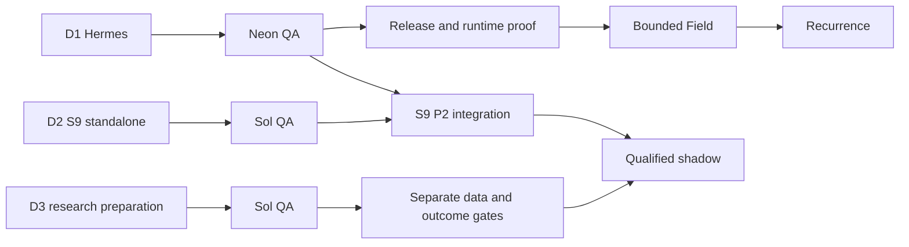

# QUANT v1.0 — Wave D–G roadmap
Date 2026-11-28 UTC+8. Current [checkpoint](V100_WAVED_ACTIVE_CHECKPOINT_20261128.md). Wave D initial Worker deliveries completed; D2 Run 2 remediation active; joint QA pending; subsequent stages proposals, not execution grants.

| Lane | Wave D (initial delivery / D2 fix) | Wave E (next) | Wave F/G (later) |
|---|---|---|---|
| Product | D1 native Hermes offline plumbing; three production blockers | D1 QA, approved exact release, staged deployment + controlled restart + authentic runtime proof; separate bounded Field; separate recurrence | Account-aware read-only advice after separate L2 gate; measured incremental network optimization |
| Architecture | D2 standalone catalog, B2 adapter, V2 journal; Run 2 fixes and regression active | S9-P2 small production wiring only after accepted D1/D2 and exact integration review | Real qualified shadow, then config selection of admitted strategies |
| Research | D3 synthetic fixed-horizon engine; protocol lock required | R4 source/OI verification and separately approved archive build; separate outcome trial approval | H03/H04 broader universe, R5 sentiment, R6 cross-asset, forward confirmation |

D1 critical path not blocked by D2/D3. Do not merge research branch into product implicitly. Pin exact commit, four wheels, asset hashes and release identity after authorized integration. Preserve legacy B2 and immutable decisions; new strategy not eligible merely because implemented. 15m normal/5m active tracking, meaningful-state notifications and 4H summaries; AI 30 ordinary/60 hard physical requests per UTC day, six protected summary slots; 10/20 runs subordinate proposed, 3/run not proven upper bound. No production dispatch if hard budget, principal or memory isolation unverified without separate Owner decision. Field proposal 2–3 sequential native runs, actual provider/model/usage and delivery, no automatic recurrence. Private account separate read-only credential, no TRADE. No optimal horizon claim; prioritize H01/H02, avoid grid and underpowered promotion. R5/R6 independent later proposals.

## Immediate sequence
1. Recover evidence and direct independent QA: D1 Neon, D2/D3 Sol. Reported 739/17/91 tests are not fresh QA. D2 Run 2 already active; do not redispatch.
2. Resolve D1 native identity, memory isolation and physical request cap; explicit Owner decision if unsupported. D2 verify four fixes and inherited regression after Run 2. D3 lock six unresolved choices before one blind count.
3. Separate D1 release/runtime/Field/recurrence; S9 P2 after D1/D2 accepted; research data/outcome gates separately authorized. No automatic promotion.
